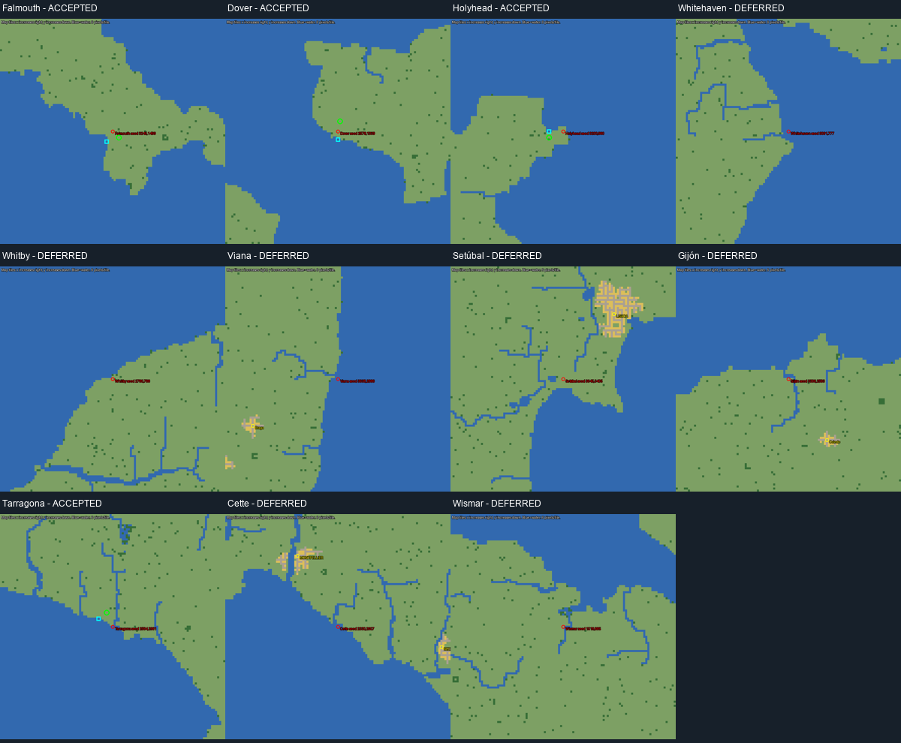

# Phase 6A — final coastal-town audit

Source: `C:\Users\Kladd\Documents\OpenTTD\scenario\Europe 1830 Historical AXIS 0.2.0 - No Industries.scn`. SHA256 `9b4dbd70e27653fcb72d5778993988d257d5f83adcaf4a394c01af110d366735`.

Separate output: `C:\Users\Kladd\Documents\OpenTTD\scenario\Europe 1830 Historical AXIS 0.2.0 - Coastal Towns.scn`. SHA256 `6c7a7b8ccbf72a744102ab06df755d119d692ca435e397e1bbbac3267ee1b60d`.

Original towns: **613**. Added: **4**. Final: **617**. Industries: **0**.

The active scenario, rather than the older 568/600-town catalogs, supplied all town identities, coordinates and populations. All 613 were screened using the real JGRPP dock command in GSTestMode, followed by passenger AND mail acceptance/production checks. Within the bounded scan, 170 towns have some legal dock site; 82 have a site meeting both catchment tests. Those 82 reference **80 distinct best dock tiles**, not 82 independent ports. Shared catchments must not be counted twice.

Screening classifications: {'Coastal town without tested practical dock': 81, 'Coastal town with legal catchment dock': 76, 'Inland town without tested maritime access': 450, 'Inland water town with legal catchment dock': 6}. Coast/river classification is MODELLED: proximity to broad water in the largest four-neighbour component. Connected rivers are not automatically called coast. The classification is a search aid, not proof of navigability. All 613 rows and unresolved location fields are preserved in `research/existing_coastal_towns.csv`.

## Historical additions

| Town | Region | Map tile (x, y) | Game population | History |
|---|---|---|---:|---|
| Falmouth | British Isles / Cornwall | 3248, 1502 | 511 | [Source](https://nmmc.co.uk/object/cornish_maritime_collection/a-packet-captains-telescope/) |
| Dover | British Isles / Channel | 2579, 1334 | 825 | [Source](https://www.portofdover.com/corporate/about/history-heritage/) |
| Holyhead | British Isles / Wales | 3193, 983 | 413 | [Source](https://cadw.gov.wales/sites/default/files/2019-05/Holyhead-%20Understanding%20Urban%20Character_0.pdf) |
| Tarragona | Iberia / Mediterranean Spain | 2581, 2974 | 887 | [Source](https://www.porttarragona.cat/en/port-city/port-archive) |

The earlier density audit and coordinate catalogs were reused for research and calibration. Eleven missing historical leads were checked against the active inventory, nearby anchors and labelled local terrain rasters. The existing calibrated projection was only an initial seed: nearby actual-town residuals were bounded to eight tiles; reviewed placement options remained within eight tiles per axis and ten Manhattan tiles. The coast was never moved to meet a coordinate. This is exact game-tile placement on a scaled map, not a claim of metre-accurate 1830 harbour surveying.

The scan is deliberately bounded to a 65×65 box and 40 Manhattan tiles around each town. A failed scan does not prove no dock can ever serve that town. Every existing historical port's significance was not independently re-researched; unsourced fields remain UNVERIFIED. Named historical gaps were investigated across the four priority regions, not treated as an exhaustive census of European ports.

Resolved gaps are the missing named ports listed above. Remaining leads and rejected duplicate/post-1830 settlements are in `research/rejected_port_candidates.csv`. Iberian Atlantic, some British industrial/river ports, Mediterranean islands, the Aegean and Black Sea still warrant local review before claiming complete historical coverage. No extra towns were invented to fill geometric gaps.

## Preservation

All original 613 CITY rows, including populations and nested saved fields, remain byte-identical. All heights, every original water tile and its metadata, existing roads/bridges/infrastructure, all 15 NewGRF identities/parameters, original DATE, PATS, ECMY, objects, industries, station and vehicle chunks are unchanged. The only differing chunks are ['MAPT', 'MAPO', 'MAP2', 'M3LO', 'MAP5', 'MAP8', 'CITY']. All **182** changed tiles are listed with old/new bytes in `research/coastal_changed_tiles.csv`; changes are new houses/roads and local grass/tree site metadata. No original water or infrastructure tile is changed.

The final scenario contains no player transport network, new vehicles or industries. Test docks/depots/ships exist only in discarded gameplay copies. The source remains unchanged. Normal game configuration and installed GRFs were not edited.
